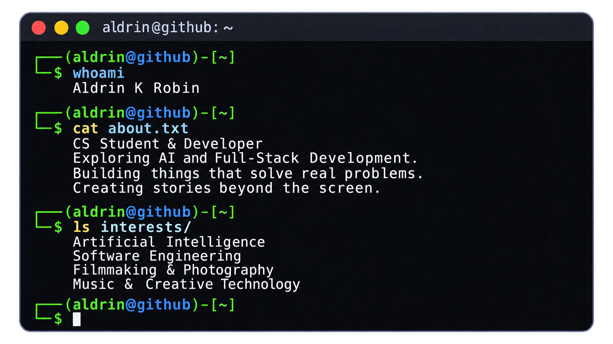

  <h1>Aldrin K Robin</h1>

  

    

  

    

  <h2>🌐 Connect With Me</h2>

  
  
  

    

  <h2>💻 Tech Stack</h2>

  
  
  
  
  
  
  
  
  
  
  
  

   

  
  
  
  
  
  

   

  
  
  
  
  
  

    

  <h2>📊 GitHub Statistics</h2>

  
  

    

  

    

  <!--
  
  <h2>🏆 GitHub Trophies</h2>

  

     

  -->

  <h2>✍️ Random Dev Quote</h2>

  

    

  <!--

  <h2>🔝 Top Contributed Repo</h2>

  

    

  -->

  

    

  ✨ Dream. Build. Create.

